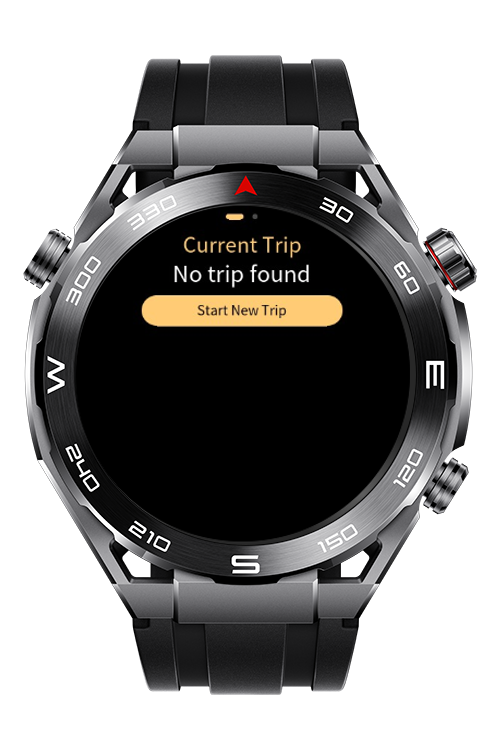
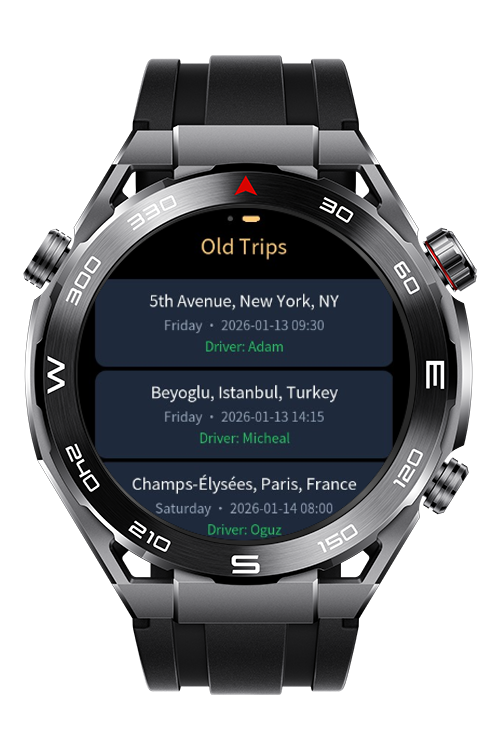
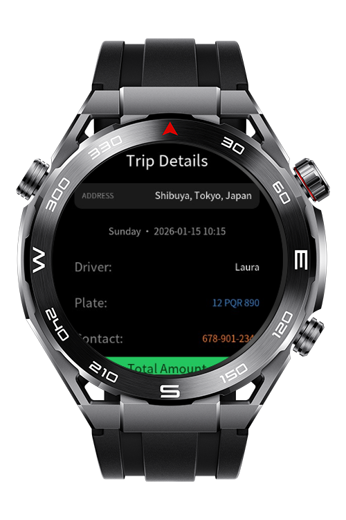
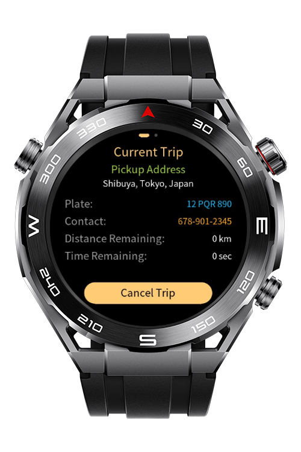

> **Note:** To access all shared projects, get information about environment setup, and view other guides, please visit [Explore-In-HMOS Index](https://github.com/Explore-In-HMOS/hmos-index).

# City Taxi

This taxi app allows users to request and cancel rides, view driver details including license plate and phone number, browse past trips, and quickly rebook previous rides.

# Preview

<div>
  
  
  
  
</div>

# Use Cases

- Call new taxi.
- Call taxi for previous trips.
- Use wear engine to start and cancel trip.

# Tech Stack

- **Languages**: HML, JS
- **Frameworks**: 5.0.0(12)
- **Tools**: DevEco Studio Version 6.0.1.251
- **Libraries**: @system.wearengine, @system.file, @system.vibrator, @system.brightness, @ohos.router

# Directory Structure

```
entry/src/main/js/MainAbility
│   app.js
├───common
│   │   constants.js
│   └───media
│           repeat.png
├───i18n
│       en-US.json
│       zh-CN.json
└───pages
    ├───index
    │       index.css
    │       index.hml
    │       index.js
    ├───tripDetail
    │       tripDetail.css
    │       tripDetail.hml
    │       tripDetail.js
    ├───utils
    │       storageUtils.js
    └───wearengine
            wearengine.js
            wearengine.js.sha256
```

# Constraints and Restrictions

## Supported Device

- Huawei Sport (Lite) Watch GT 4/5/6
- Huawei Sport (Lite) GT4/5 Pro
- Huawei Sport (Lite) Fit 3/4
- Huawei Sport (Lite) D2
- Huawei Sport (Lite) Ultimate

# License

**City Taxi** is distributed under the terms of the MIT License
See the [LICENSE](./LICENSE) for more information.